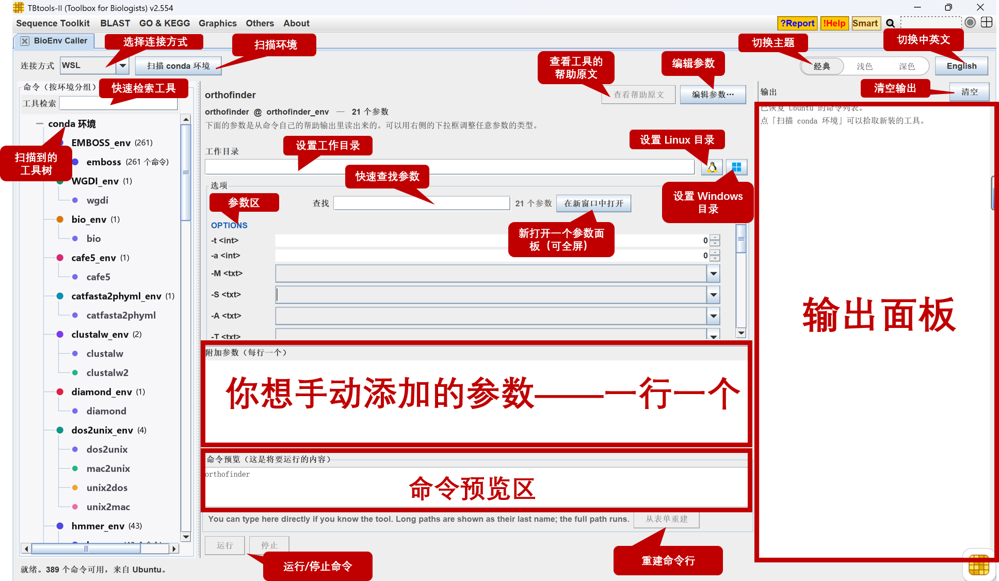
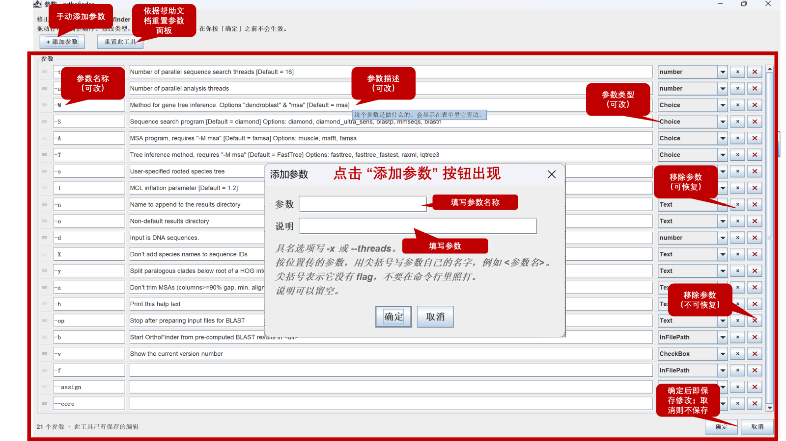
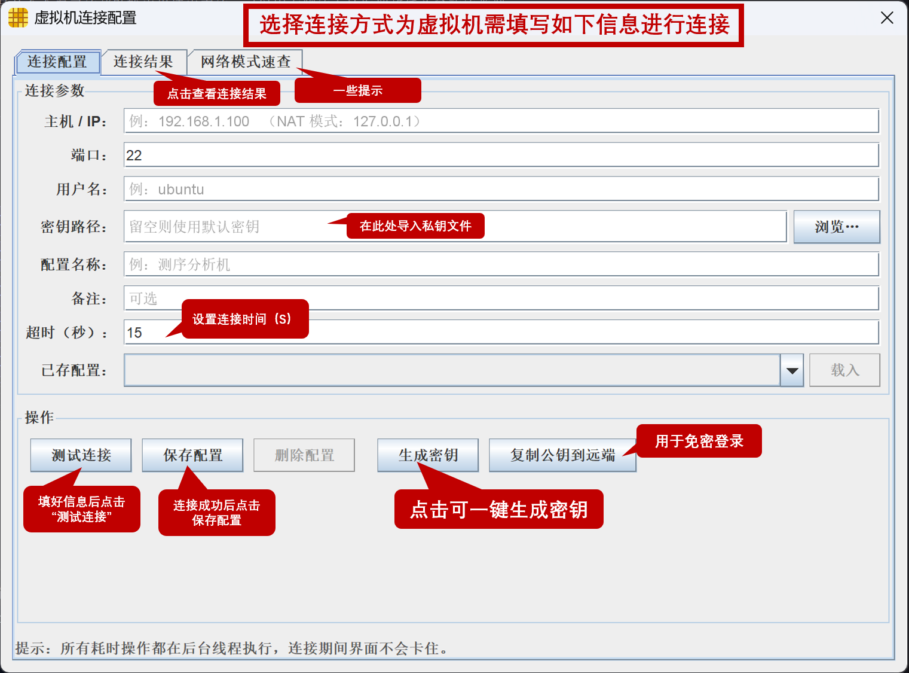
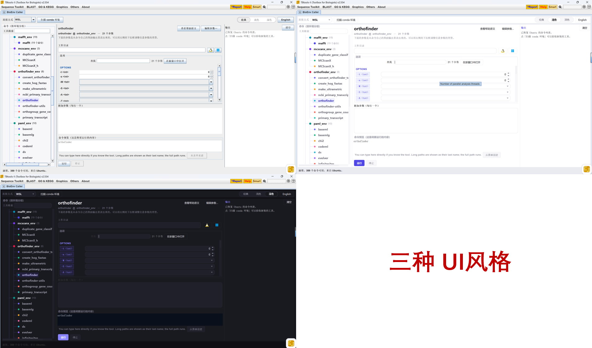

# BioEnv Caller —— 一个用于调用 WSL 或 Linux 虚拟机里 conda 环境中生信工具的 TBtools 插件
 
## 首次安装使用该插件，配置好 WSL 或 Linux 虚拟机后，一定手动点一次”扫描 conda 环境“。

---

## 这是什么

你在 WSL（适用于 Linux 的 Windows 子系统）或 Linux 虚拟机里用 conda 创建的虚拟环境中安装了很多生物信息工具。

但每次调用都要先进入相应的环境，写命令行调用相应的工具。

更难受的是，如果你长时间未使用，命令行怎么写早就忘了，于是你开始查帮助，重新理清各个参数，然后才能运行，既费时间，又耗精力。

**BioEnv Caller 把两者连接起来**：

1. 自动找到所有 conda 创建的虚拟环境
2. 列出每个环境里**你安装的工具**（不含它们带进来的依赖）
3. 读取工具的帮助文档，**自动生成参数填写界面**
4. 你填好参数，点 Run，插件在 WSL 里执行
5. 输出实时显示在 TBtools 窗口里

**它是通用的** —— 不认识任何具体工具的名字。
装了新工具，重新扫描一次就能看到，不需要改插件。


---


## 一、主界面



---

## 二、编辑参数面板

第一次用调用某个工具时，必须先在该面板设置参数类型！！！ —— **参数类型定一次就记住了，下次打开直接用**。



功能：
     
	 1. 修改参数类型
	 
     2. 添加新参数————帮助文档解析不出来？少参数？不用担心，你可以通过“添加参数”功能来解决这个难题！
	 
	 3. 删除参数————帮助文档解析的不对？别担心，一键删除功能也有！
	 
	 4. 一键还原————删错了参数？没关系，后路已经为你想好了！
	 
	 5. 遇到位置参数也不要担心————<参数名>格式专门解决这个问题（参数名用“<>”括起来，就不会被写入到命令当中去）！


### 参数类型选哪个

| 类型 | 用途 | 长什么样 |
|---|---|---|
| **InFilePath** | 要一个**输入文件**（填 Windows 路径即可） | 文本框 + `...` 浏览按钮 |
| **PasteAsInFilePath** | 要一个输入文件，但**你手动粘贴路径**（不自动复制到 WSL） | 文本框 |
| **OutFilePath** | 要一个**输出文件** | 文本框 + `...` 浏览按钮 |
| **TextAsOutFilePath** | 要一个输出文件，但**只填文件名**就行（插件补全目录） | 文本框 |
| **DirectoryPath** | 要一个**目录** | 文本框 + `...` 浏览按钮 |
| **FilePathList** | 要**多个文件**（用英文逗号分隔） | 文本框 |
| **FilePathListInFile** | 要多个文件，但**写在清单文件里**（这里填那个清单文件） | 文本框 + `...` 浏览按钮 |
| **Choice** | 从几个**固定值**里选一个 | 下拉框 |
| **CheckBox** | 一个**不带值的开关** | 勾选框 |
| **number** | 只要**数字** | 数字框（带上下箭头） |
| **Text** | **普通文本**，原样传给工具 | 文本框 |
| **None** | **不显示**这个参数 | 无控件 |

---

## 三、WSL、Linux 虚拟机如何连接？

### WSL

打开插件，点「扫描 conda 环境」即可 —— **不用配任何连接信息**。

### Linux 虚拟机

插件里选「Linux 虚拟机」后，会弹出下面图片所示的窗口



---

#### 第 1 步：先拿到「主机 / IP」和「端口」

**看虚拟机在哪里、网卡是什么模式**，按下表确定：

**虚拟机就装在这台电脑上**

| 网络模式 | 主机 / IP | 端口 | 还要做什么 |
|---|---|---|---|
| **桥接** | 虚拟机的**真实 IP**（虚拟机里 `ip addr` 查） | `22` | 无 |
| **NAT**（VMware 默认） | `127.0.0.1` | `2222` | **必须先配端口转发**：VMware →「编辑 → 虚拟网络编辑器 → VMnet8 → NAT 设置 → 添加」，主机端口 `2222` → 虚拟机 IP 的 `22` |
| **仅主机（Host-Only）** | **VMnet1 网段**里的虚拟机 IP | `22` | 无（Windows 上 `ipconfig` 看 VMnet1 网段） |

> **NAT 最容易踩坑**：不配端口转发就一定连不上，改填虚拟机的内网 IP 也没用。

**虚拟机在别的地方（不在这台机器 / 不在同一局域网）**

| 虚拟机在哪 | 主机 / IP | 端口 | 前提 |
|---|---|---|---|
| 同一局域网的另一台机器 | 那台机器的 IP | `22` | 对方防火墙放行 |
| 不同网段 / 外网 | 那台机器的**公网 IP** | 映射出来的端口（如 `2222`） | 路由器上做端口映射，且那台机器上的虚拟机做了 NAT 转发 |
| 不同网段（**推荐**） | 组网后那台机器的**虚拟 IP** | `22` 或 `2222` | 两台电脑都装 Tailscale / ZeroTier 之类，进同一个网络 |

> **最省事的两种做法**：① 在宿主机上把虚拟机网卡设成**桥接**，它就象局域网里一台独立机器；
> ② 用**异地组网**工具把两台电脑拉进同一个虚拟局域网，再按「本机」那张表填。

---

#### 第 2 步：在插件里填四个字段

| 字段 | 填什么 |
|---|---|
| **主机 / IP** | 第 1 步查到的地址 |
| **端口** | 第 1 步查到的端口 |
| **用户名** | **建虚拟机时设的那个 Linux 用户名** |
| **密钥路径** | 你的私钥文件；还没有就先做第 3 步 |
| **配置名称** | 给你的配置起个名字 |

其他的可以不填

---

#### 第 3 步：生成密钥并装到虚拟机上（第一次必须做）

**为什么必须做**：插件连虚拟机用 SSH，而且**不允许任何交互**（不会弹密码框让你输）。
它靠「私钥 + 虚拟机上的公钥」验证身份 —— **虚拟机上没有配对的公钥，就一定连不上。**

1. 在配置窗口点 **`生成密钥`** → 生成一对密钥。
2. 把生成的**私钥**路径填进 **`密钥路径`**
3. **将公钥发送至虚拟机**：在 powershell 中执行下面这条命令，**会提示输密码**

```powershell
type $env:USERPROFILE\.ssh\vm_key.pub | ssh 用户名@主机 -p 端口 "mkdir -p ~/.ssh && chmod 700 ~/.ssh && cat >> ~/.ssh/authorized_keys && chmod 600 ~/.ssh/authorized_keys"
```

> `vm_key.pub` 换成你实际的公钥文件名；`主机`、`端口` 用第 1 步查到的。

4. 回到插件点 **`测试连接`** —— 点击连接结果查看是否连接成功

> **插件里那个 `复制公钥到远端` 按钮，第 3 步用不了** —— 它自己也不弹密码框，
> 只适用于「已经能免密连上」的情况。**第一次请用上面那条命令。**

---

#### 第 4 步：保存配置

`测试连接` 成功后点 **`保存配置`**，起个名字 —— 下次在 **`已存配置`** 里选一份、点 **`载入`** 就填回来了。
多台虚拟机就存多份。

---

#### 连不上时

先看 **「连接结果」**那一页，再对照：

| 现象 | 原因 | 解决 |
|---|---|---|
| 连不上 | 地址错、虚拟机没开机、网络不通、**NAT 没配端口转发** | 先在 Windows 上 `ping 主机`；再 `ssh 用户名@主机 -p 端口` 试一次 |
| 提示端口被拒绝 | 主机通，但 **sshd 没在听** | 虚拟机里：`sudo apt install openssh-server && sudo systemctl enable --now ssh` |
| 要密码 / 认证失败 | **公钥还没装到虚拟机上** | 回到第 3 步，手工装一次 |
| 连上了但没有 conda | 虚拟机上没 conda，或不在登录 shell 的 PATH 里 | 在虚拟机上执行 `conda --version` 确认 |
| 还没扫过这个目标 | 换了主机 / 用户 / 端口之后第一次 | 点一次 `扫描环境` |

---
## 四、三种界面风格



右上角 **经典 / 浅色 / 深色** 点一下即换。经典就是 TBtools 原生外观。

---

## 附录：安装 WSL 并配置 conda

参考如下两篇公众号：

- https://mp.weixin.qq.com/s/aecYDyl1f2pzL5ROpsz7dg
- https://mp.weixin.qq.com/s/zurwuO35CXCvEYaUBLR2ww

**只有一点要记住**：工具要装在 **`conda create -n 名字` 建的具名环境**里，不要装在 `base`。

```bash
conda create -n of3_env
conda activate of3_env
conda install bioconda::orthofinder
```
