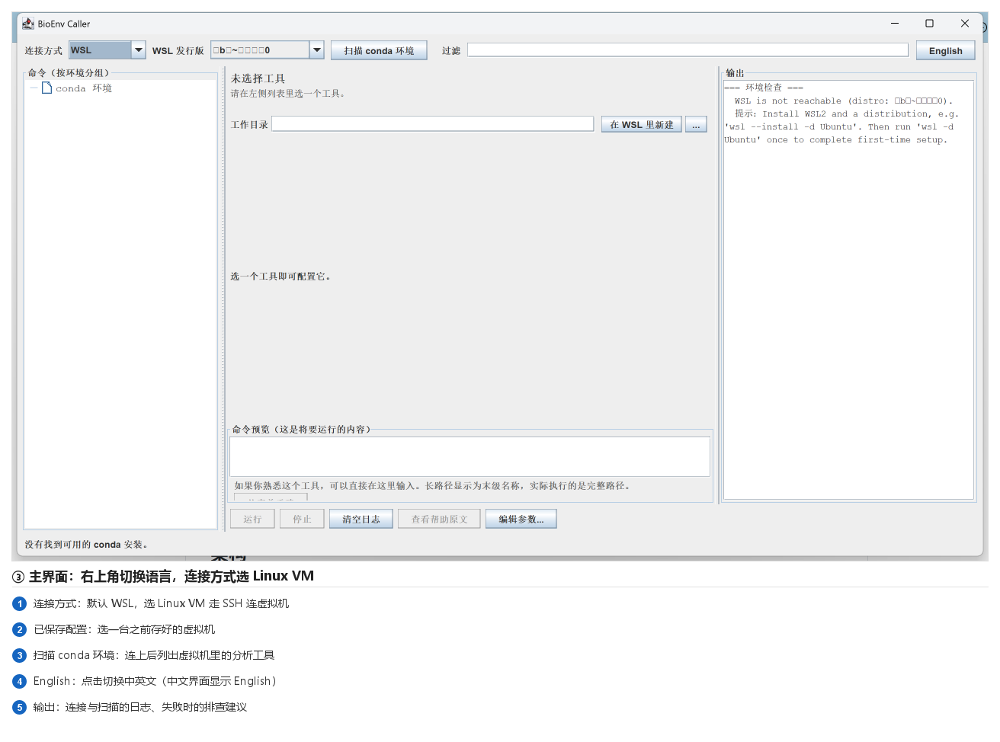
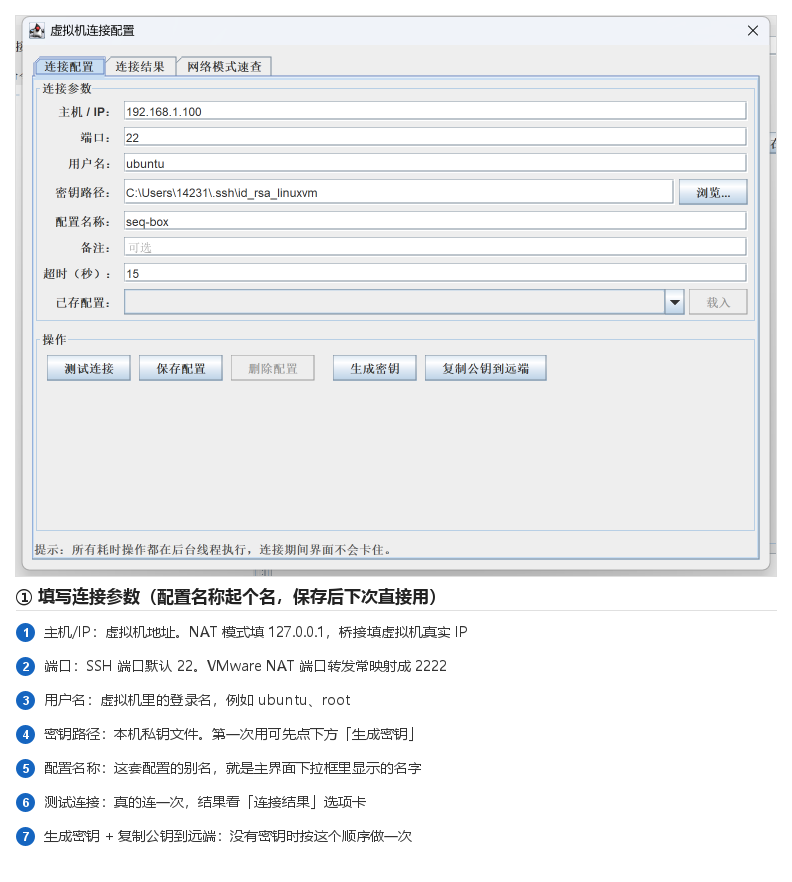
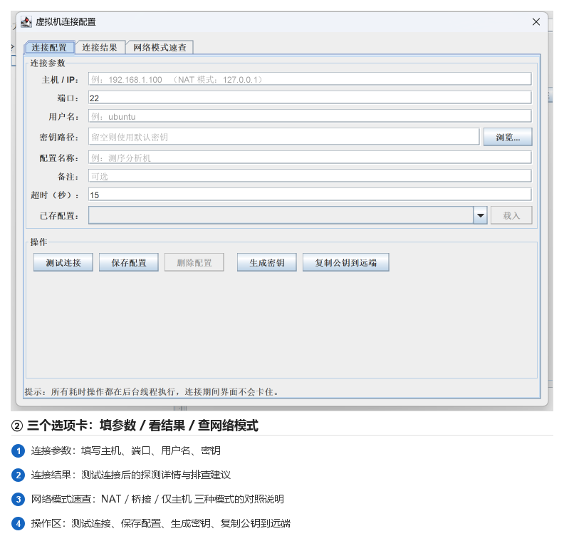
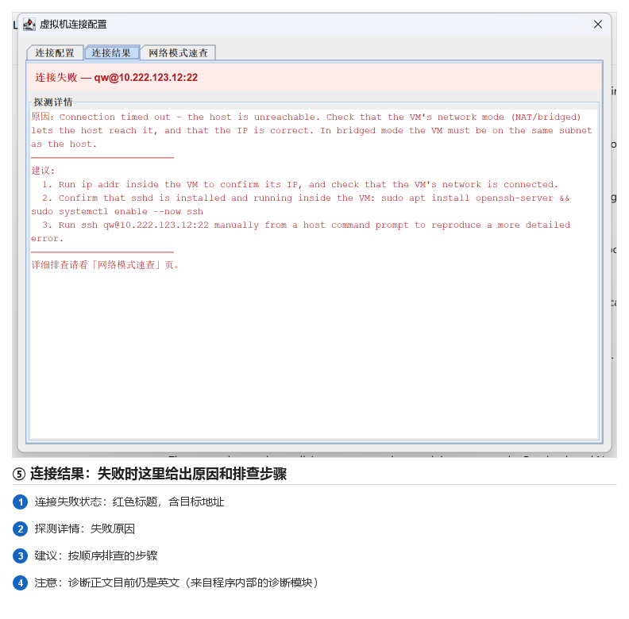
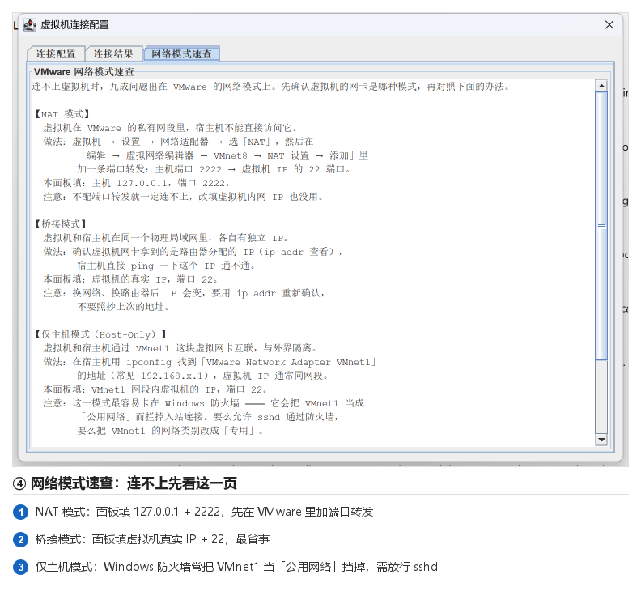

# 连接 Linux 虚拟机 — 操作说明

本文带你从零把 TBtools 的 **BioEnv Caller** 插件连上一台 VMware Linux 虚拟机。

> 配图都是从**真实运行的插件界面**截取后标注的，不是示意图。
> 文中标注「未实测」的步骤，是因为开发机上没有安装 VMware、也没有可连的虚拟机。

---

## 0. 开始之前：先搞清楚三件事

| 事项 | 说明 |
|---|---|
| **登录方式** | 本插件**只支持密钥登录**，不支持密码。原因：连接时用了 `BatchMode=yes` 禁止一切交互提问，没有地方输入密码。没有密钥也没关系，第 3 步可以一键生成。 |
| **虚拟机上要有 sshd** | 虚拟机里必须装好并启动 SSH 服务，否则连不上。第 1 步检查。 |
| **要装 conda** | 插件扫描的是虚拟机里的 conda 环境。没装 conda 能连上，但列不出工具。 |

---

## 1. 在虚拟机里把 sshd 跑起来

在**虚拟机内部**（不是宿主机）执行：

```bash
# 确认 sshd 是否在运行
systemctl status ssh

# 没装就装（Ubuntu / Debian）
sudo apt update && sudo apt install -y openssh-server
sudo systemctl enable --now ssh

# 确认在监听 22 端口
ss -lntp | grep sshd

# 查虚拟机的 IP（桥接 / 仅主机模式需要用到）
ip addr
```

**要点**：`ss -lntp` 要能看到 sshd 监听在 `:22`。如果 `systemctl status ssh` 显示 `inactive (dead)`，后面所有步骤都不会成功。

---

## 2. 在 VMware 里确认网络模式

这一步决定你第 4 步「主机 / IP」填什么。三种模式对照：

| 网络模式 | 面板里填什么 | 备注 |
|---|---|---|
| **NAT**（默认） | `127.0.0.1` + 端口 `2222` | **必须先加端口转发**，否则一定连不上 |
| **桥接（Bridged）** | 虚拟机真实 IP + 端口 `22` | 最省事，推荐 |
| **仅主机（Host-Only）** | VMnet1 网段 IP + 端口 `22` | ⚠️ Windows 防火墙常把 VMnet1 当「公用网络」挡掉 |

### NAT 模式：加端口转发（详细步骤）

1. VMware 菜单 **编辑 → 虚拟网络编辑器**
2. 点右下角 **更改设置**（需要管理员权限，会弹 UAC）
3. 选中 **VMnet8**（NAT 模式那个）
4. 点 **NAT 设置…** → **添加…**
5. 按下表填写，然后一路确定：

   | 字段 | 填 |
   |---|---|
   | 主机端口 | `2222` |
   | 类型 | `TCP` |
   | 虚拟机 IP 地址 | 虚拟机的 IP（`ip addr` 查到的） |
   | 虚拟机端口 | `22` |

6. 之后插件面板里就填 **主机 `127.0.0.1`**、**端口 `2222`**

---

## 3. 打开插件，切到 Linux VM

在 TBtools 里从 `AI+` 菜单打开 **BioEnv Caller**。



1. **连接方式** 下拉：默认是 `WSL`，切换成 **`Linux VM`**
2. 切过去之后，**连接配置窗口会自动弹出来**（前提是你从没连成功过——连成功过之后就不再打扰你了）
3. 右上角的 **`English`** 按钮可以切换中英文

> **什么时候会自动弹窗？** 从未连接成功过 → 切到 Linux VM 时自动弹出，引导你填。
> 一旦连接成功过，就不再自动弹；需要改配置时重新切一次连接方式即可再次弹出。

---

## 4. 填写连接参数



按上图从上往下填。以 **桥接模式** 为例：

| 字段 | 示例 | 说明 |
|---|---|---|
| **主机 / IP** | `192.168.1.100` | NAT 模式填 `127.0.0.1` |
| **端口** | `22` | NAT 端口转发时填 `2222` |
| **用户名** | `ubuntu` | 虚拟机里的登录名 |
| **密钥路径** | `C:\Users\你\.ssh\id_rsa_linuxvm` | 本机（Windows）私钥文件。**留空**则用 ssh 默认密钥 |
| **配置名称** | `seq-box` | 起个名，保存后主界面下拉框里就用这个名字 |
| **备注** | 可选 | 纯备忘，不参与连接 |
| **超时（秒）** | `15` | 连不上时等多久放弃 |

窗口有三个选项卡：



| 选项卡 | 作用 |
|---|---|
| **连接配置** | 就是上面那张表单 |
| **连接结果** | 「测试连接」之后的结果与排查建议 |
| **网络模式速查** | NAT / 桥接 / 仅主机 三种模式的中文说明 |

---

## 5. 生成密钥（如果还没有）

如果你**没有**现成的密钥对，按这个顺序做：

1. 点 **生成密钥** —— 调用 Windows 自带的 `ssh-keygen` 生成一对密钥
2. 点 **复制公钥到远端** —— 把公钥装进虚拟机的 `~/.ssh/authorized_keys`
   （这一步需要虚拟机的密码，是**唯一**需要密码的地方；也可以手动做，见下方备选）
3. 把生成的私钥路径填进 **密钥路径**

<details>
<summary>备选：手动装公钥（不想用「复制公钥到远端」时）</summary>

在 **Windows** 上执行（把路径和用户名换成你自己的）：

```powershell
type $env:USERPROFILE\.ssh\id_rsa_linuxvm.pub | ssh ubuntu@192.168.1.100 "mkdir -p ~/.ssh && chmod 700 ~/.ssh && cat >> ~/.ssh/authorized_keys && chmod 600 ~/.ssh/authorized_keys"
```

然后在虚拟机里确认权限正确（**权限不对 sshd 会拒绝使用密钥，且报错很隐晦**）：

```bash
chmod 700 ~/.ssh
chmod 600 ~/.ssh/authorized_keys
```
</details>

---

## 6. 测试连接

点 **测试连接**，切到 **连接结果** 选项卡看结果。

**成功**时你会看到操作系统、内核版本、家目录。

**失败**时是这样：



> ⚠️ **注意**：上图中红色标题和底部那句是中文，但**中间的诊断正文目前仍是英文**。
> 那部分来自程序内部的诊断模块（`core` 层），还没有做中文翻译。这是已知状态，不是你的操作问题。

按里面的「建议」逐条排查即可。

---

## 7. 连不上？先看「网络模式速查」

这是排查时最有用的一页，把三种模式的做法写得很具体：



### 常见报错对照表

| 报错 | 原因 | 怎么解决 |
|---|---|---|
| `Connection timed out` | 网络不通 | NAT 没加端口转发 / 防火墙挡了 / IP 填错 |
| `Connection refused` | 到了机器但没服务 | 虚拟机里 sshd 没启动：`sudo systemctl start ssh` |
| `Permission denied (publickey)` | 密钥没装好 | 公钥没进 `authorized_keys`，或权限不是 700/600 |
| `Host key verification failed` | 主机指纹变了 | 宿主机执行 `ssh-keygen -R 主机名` 后重试 |
| `Could not resolve hostname` | 主机名写错 | 检查「主机 / IP」这一栏 |

---

## 8. 保存，然后扫描工具

1. 回到 **连接配置** 选项卡
2. **配置名称** 起个名 → 点 **保存配置**
3. 关闭窗口，主界面下拉框里就有这台机器了
4. 点 **扫描 conda 环境**

成功后左侧会按环境列出虚拟机里的分析工具，点任意一个就能在右边填参数、运行。

> 如果提示「没有找到可用的 conda 安装」，说明连上了但虚拟机里没装 conda。
> 在虚拟机里装 Miniconda 后重新扫描即可。

---

## 9. 常见问题

**Q：为什么连接配置窗口有时候不自动弹了？**
A：连成功过就不再自动弹（避免每次切模式都被窗口打断）。想再弹出来，把连接方式切到 `WSL` 再切回 `Linux VM`。

**Q：能记住我的设置吗？**
A：能。语言选择存在 `%USERPROFILE%\.TBtools\BioEnvCaller\language.txt`，连接配置存在 `%USERPROFILE%\.vmadapt\connections.json`。**密码永不落盘**（本来也只用密钥）。

**Q：怎么重置「已经连成功过」这个状态？**
A：删掉 `%USERPROFILE%\.TBtools\BioEnvCaller\linked.txt` 即可。

**Q：参数区的说明为什么有的是中文有的是英文？**
A：那些说明来自**被调用工具自己的 `--help` 输出**。插件内置了一份常用短语的中译（如 `input file` → `输入文件`），**短句已中文化**；较长的句子、以及尚未收录工具（如 OrthoFinder）的说明会**原样显示英文**。英文模式下则全部显示原文。

---

## 附：本文档的验证程度

| 内容 | 状态 |
|---|---|
| 界面截图与标注 | ✅ 全部来自真实运行的插件，逐张核对 |
| 按钮 / 字段的说明 | ✅ 对照源码逐一核对 |
| 失败路径（连接超时） | ✅ 实际发起过连接，等到了真实超时 |
| VMware 安装、图形界面操作 | ⚠️ **未实测** — 开发机未安装 VMware |
| 真实 SSH 握手 / scp 传输 | ⚠️ **未实测** — 无可用虚拟机，22 端口无 sshd |

更详细的 VMware 网络配置，见 [VMware连接指南.md](VMware连接指南.md)。
