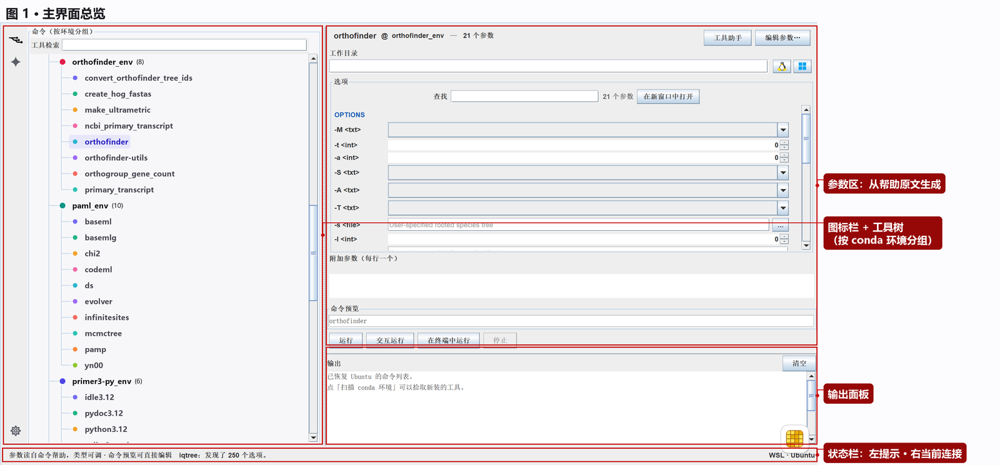
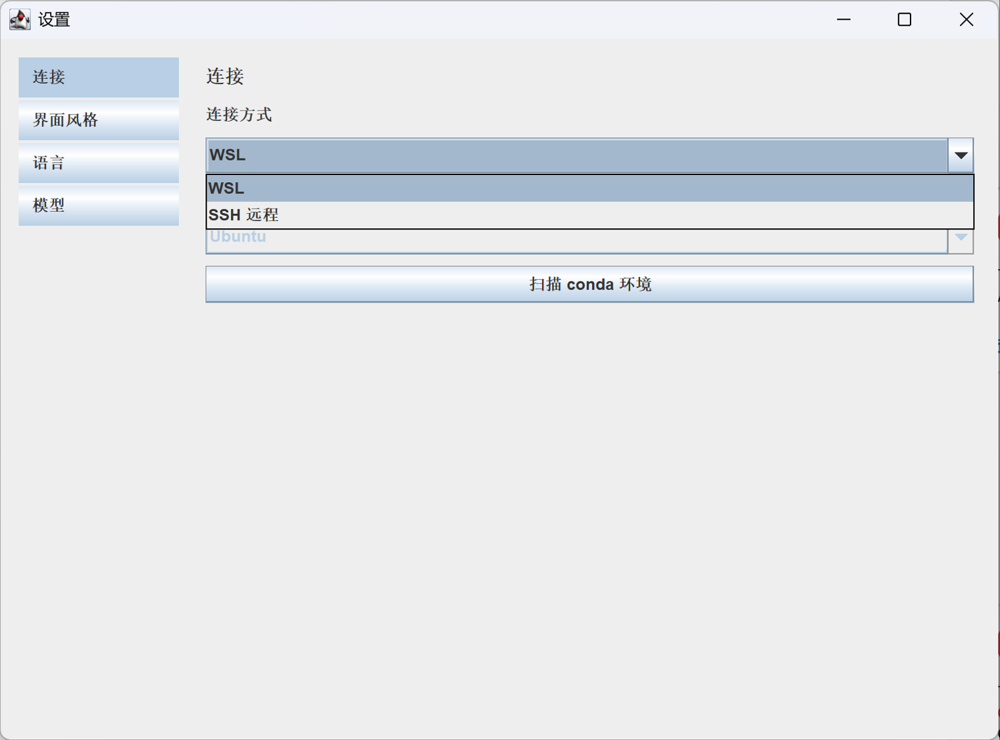
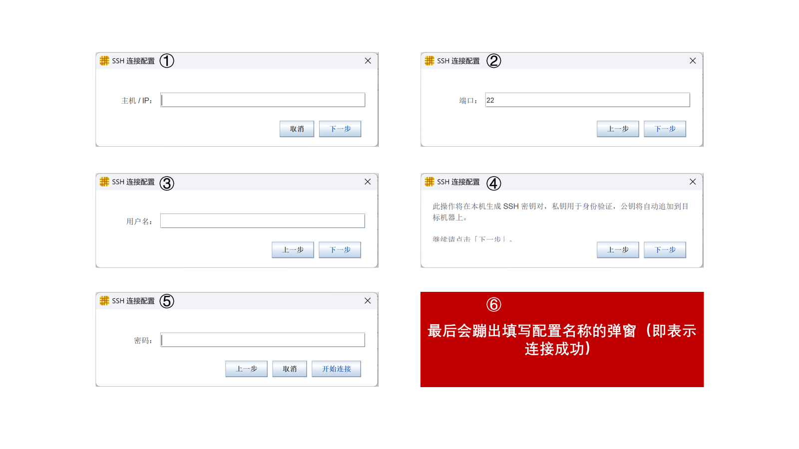
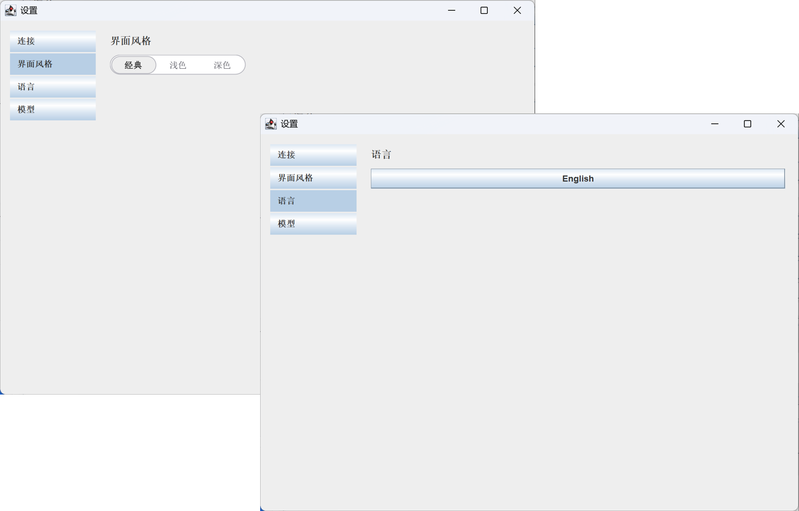
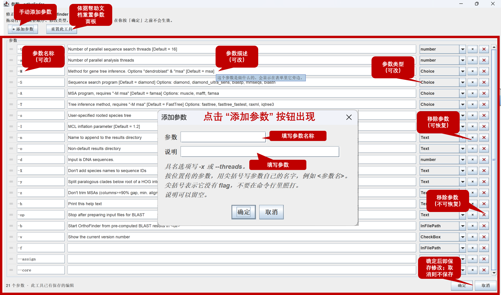
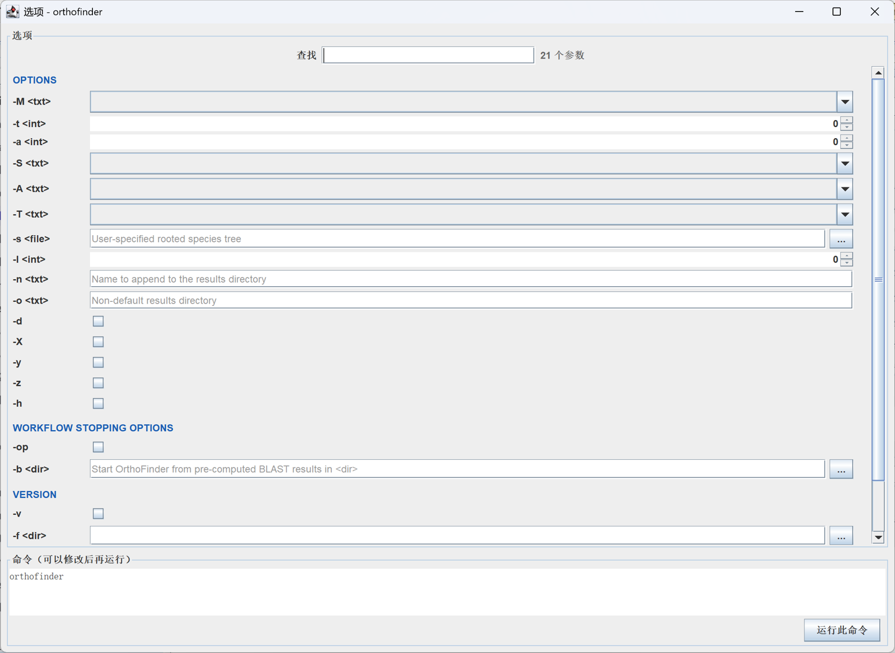
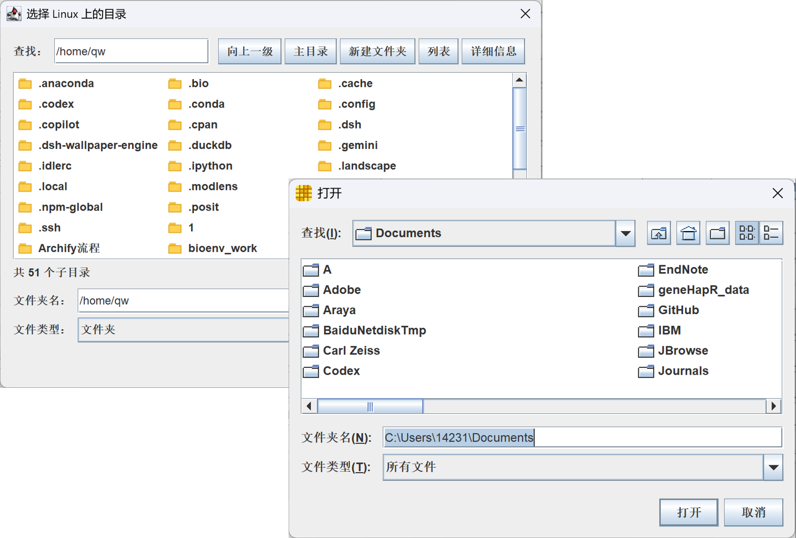
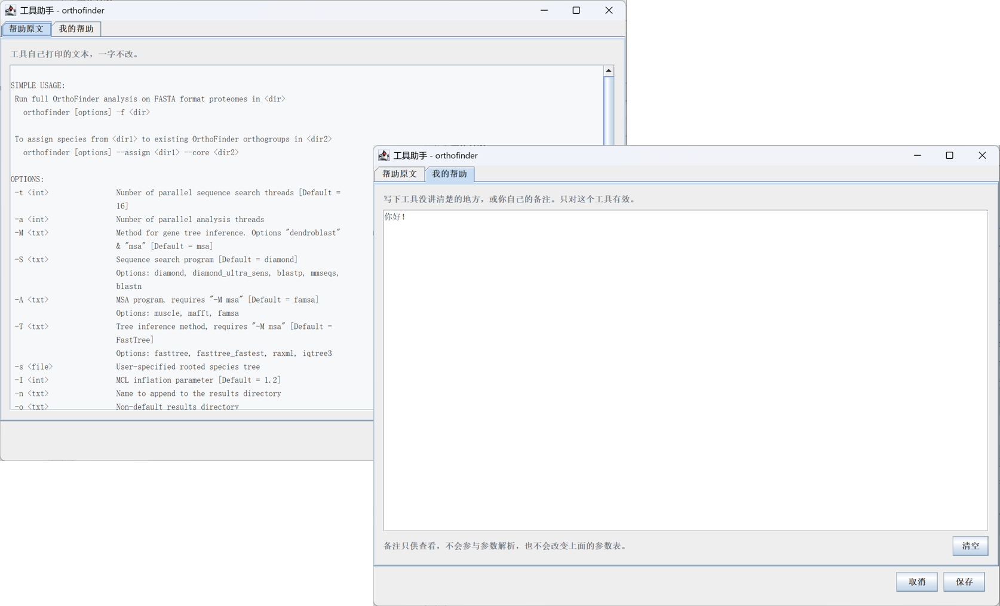
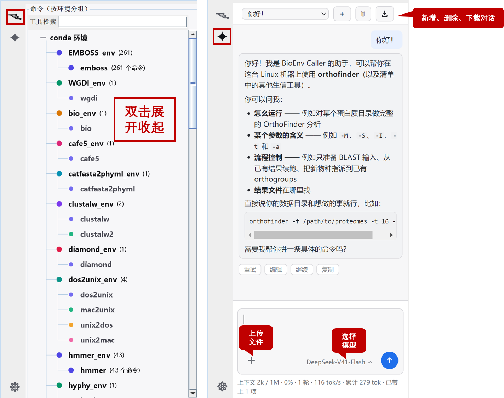
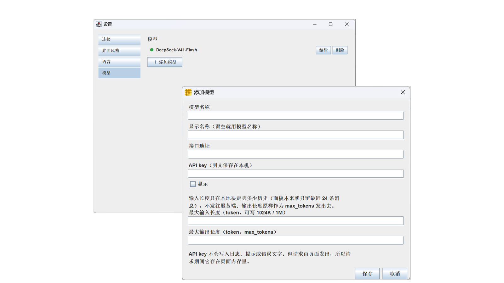

# BioEnv Caller 使用说明（图文版）

> **BioEnv Caller** 是 TBtools 的一个插件：把 **Linux 上的命令行生信工具**变成图形界面，并配一个**看得见当前工具上下文的 AI 助手**。
>
> 运行位置：**本机 WSL** 或 **SSH 远程主机**。

| 图 | 这一页讲什么 |
|---|---|
| [图 1](#4-界面总览) | 主界面：每个按钮在哪 |
| [图 2](#5-连接环境) | 设置 → 连接 |
| [图 3](#52-ssh-远程方式) | SSH 连接向导（六步） |
| [图 4](#6-外观与语言) | 设置 → 界面风格 / 语言 |
| [图 5](#97-把参数面板弹成独立窗口) | 新窗口里的参数面板 |
| [图 6](#98-选文件linux-目录--windows-文件) | 选 Linux 目录 / 选 Windows 文件 |
| [图 7](#8-第一次用一个工具先校准参数) | 编辑参数：先校准，再改/加/删 |
| [图 8](#11-工具助手) | 工具助手（帮助原文 / 我的帮助） |
| [图 9](#12-ai-助手) | AI 助手面板 |
| [图 10](#13-设置模型) | 模型设置 |

---

## 0. 三分钟上手

```
① 装插件 → ② 设置里选 WSL/SSH → ③ 扫描 conda 环境
→ ④ 左边点一个工具 → ⑤ 先在「参数编辑面板」校准参数
→ ⑥ 填参数 → ⑦ 运行
```

1. 打开 **BioEnv Caller** 标签页（Orthos → ）
2. 点最左侧图标栏最底部的 **⚙ 设置项** → **连接** 页 → 选 `WSL`（或 `SSH 远程`，需根据弹窗要求进行配置）→ 点 **扫描 conda 环境**
3. 左边出现"环境 → 工具"的树 → 点一个工具
4. **第一次用这个工具：先点「参数编辑面板」校准参数**（见 [第 8 章](#8-第一次用一个工具先校准参数)）
5. 中间填参数
6. 看一眼 **命令预览区** → 点 **运行**

---

## 1. 这个插件是干什么的

生信工具大半是命令行程序，要在终端中运行：参数几十个、帮助是英文、路径要在 Windows 和 Linux 之间来回倒腾。

| 痛点 | 这个插件的做法 |
|---|---|
| 记不住参数、拼不对命令 | 选工具 → **自动生成参数表单** → 自动拼出命令；命令框还能直接改 |
| 看不懂某个参数 | **工具助手**里放工具自己的帮助原文；更细的问题问 **AI 助手**（它自动带着当前工具的帮助、参数表、工作目录、上次的报错） |
| Windows 上不好跑 Linux 工具 | 直接连 **WSL** 或 **SSH 远程**，在那边跑，输出回传到插件里 |

**它不是**：不是 Windows 原生工具的界面，不是流程编排（workflow）工具，也不替代命令行 —— 它就是"把这一个命令填对、跑起来、看懂输出"。

---

## 2. 能连接哪些环境

### 2.1 WSL（本机，先用这个）

- 连 **Windows 上已安装的 WSL 发行版**（Ubuntu / Debian / …；装了多个会列出来让你选）
- 要求：Windows 10/11，WSL 装好并能正常进 shell
- WSL 和 Windows 之间有 `/mnt/c`，**Windows 路径在 WSL 里本来就能直接用**

### 2.2 SSH 远程

- 连 **任何能用 `ssh` 登录的 Linux 主机**：云服务器、实验室工作站、超算登录节点
- 需要：主机名或 IP、端口（默认 22）、用户名、**密码或密钥**
- 支持多个**已保存配置**（一个名字对一台机器），随时切换
- 向导里可以**生成密钥并装到服务器**，之后免密登录
- **虚拟机也一样**：VMware / VirtualBox / Hyper-V 里跑的 Linux，对插件来说就是一台 SSH 主机 —— 具体三步见 [5.3](#53-连的是虚拟机vmware--virtualbox--hyper-v)

> SSH 下没有 `/mnt/c`：选 Windows 上的文件时，插件会**把文件复制进 Linux 侧工作目录**，再把复制后的路径填进参数。

### 2.3 工具从哪来

工具**不是手工登记的**，是从 conda 环境里扫出来的：找 conda 安装位置 → 遍历环境 → 列出每个环境里能执行的命令。

- **Linux 侧 `conda install` 了什么，扫一下这里就有什么**
- 新装工具后点「扫描 conda 环境」刷新；有缓存，环境没变时很快

**注意**：插件仅扫描用conda创建的虚拟环境中的工具，不扫安装在 base 环境的工具！

---

## 3. 安装与要求

| 项目 | 要求 |
|---|---|
| 宿主 | **TBtools-II** |
| 系统 | Windows 10 / 11 (x64) |
| 运行环境 | 本机 **WSL2**，或可 SSH 登录的 **Linux 主机** |
| AI 助手（可选） | TBtools **2.558+**（TBmodel 桥）；网页运行时（JxBrowser）由 TBtools 按需下载 |
| 不装 AI 也能用 | 除 AI 那条之外，所有功能不依赖网络和模型 |

安装：TBtools → 插件菜单 → **Install Plugin** → 选 `BioEnvCaller.plugin`

---

## 4. 界面总览



| 位置 | 叫什么 | 干什么 |
|---|---|---|
| 最左窄条 | **图标栏** | 两个开关 + 一个入口：**点击展开工具树**、**点击展开 AI 助手**、最底下的 **⚙ 设置项** |
| 左上 | **工具树** | 按 conda 环境分组的命令列表；顶部是**快速检索工具**框 |
| 右上 | **参数区** | 当前工具的参数表单 + 命令预览 + 运行按钮 |
| 右下 | **输出面板** | 命令打印的内容；右上角**清空输出面板的内容** |
| 最底 | **状态栏** | 左边一句提示，右边当前连接（如 `WSL · Ubuntu`） |

**图标栏的开关**：点一下展开对应的卡，再点一下收起。工具树和 AI 助手**共用同一列**，所以只有一份宽度 —— **分隔条可以拖**，宽度会记住；**双击分隔条**恢复默认。

---

## 5. 连接环境

点 **⚙ 设置项** 打开设置窗口（独立窗口，可最大化），左侧四个分页，第一页就是 **连接**。



### 5.1 WSL 方式

1. **连接方式** 选 `WSL`
2. 点 **扫描 conda 环境**

扫描期间状态栏会显示进度；扫完显示 `就绪。999 个命令可用，来自 Ubuntu。`

### 5.2 SSH 远程方式

**连接方式** 选 `SSH 远程` → 第一次会自动建一条配置，也可以点「＋ 新增配置」走向导。



六步，一步一屏：

| 步 | 填什么 | 说明 |
|---|---|---|
| ① | **主机 / IP** | 服务器地址或域名 |
| ② | **端口** | 默认 22 |
| ③ | **用户名** | 登录账号 |
| ④ | （只读提示） | 说明：会在本机生成 SSH 密钥对，私钥用于身份验证，公钥自动追加到目标机器 |
| ⑤ | **密码** | 填完点 **开始连接** |
| ⑥ | **配置名称** | 连接成功后会弹窗让你给这套配置起个名字（以后在下拉框里选） |

连不上时说清是哪一类：**拒绝连接**（端口不对/服务没开）、**超时**（网络或防火墙）、**主机解析不了**（主机名写错）。

### 5.3 连的是虚拟机（VMware / VirtualBox / Hyper-V）

虚拟机里的 Linux 对插件来说就是一台 **SSH 主机**，协议和云服务器完全一样。只是有四件事要先确认好，否则向导能连上也拿不到工具。

#### ① 选虚拟机的网络模式（决定 IP 填什么）

虚拟机软件里有**三种网络模式**，能不能连、该填哪个 IP 完全不一样：

| 模式 | 宿主机能直连吗 | 插件里填什么 | 注意 |
|---|---|---|---|
| **桥接（Bridged）** | ✅ 能 | 虚拟机在**局域网里的 IP** + 端口 `22` | 虚拟机像一台独立机器，**同一局域网的其他电脑也能连它**；换网络后 IP 会变 |
| **NAT** | VMware：✅ 能<br>VirtualBox：❌ **默认不能** | VMware：NAT 网段的 IP + `22`<br>VirtualBox：主机填 `127.0.0.1`，端口填**端口转发**里设的端口 | 最常用：虚拟机**还能上网**装 conda 包 |
| **仅主机（Host-Only）** | ✅ 能 | 仅主机网段的 IP + `22` | **虚拟机没有外网**，`conda install` 会失败；装完工具再切回 NAT/桥接，或加第二块网卡 |

**怎么知道当前是哪种模式？** 在虚拟机里看有没有默认网关：

```bash
ip route | grep default
```

- 有输出（`default via 192.168.xxx.1 …`）→ **桥接或 NAT**（能上网）
- **没有任何输出** → **仅主机**（离线网络）

VMware 里也可以直接看：虚拟机设置 → 网络适配器 → 右边「网络连接」选的是哪种。

> **推荐：VMware 用 NAT**。宿主机能直连、虚拟机又能上网，IP 也不会随外部网络变化。
>
> VirtualBox 用 NAT 的话，要给 22 端口做**端口转发**：
> 设置 → 网络 → 高级 → 端口转发 → 新增一条（主机端口 `2222` → 子系统端口 `22`）。
> 之后插件里主机填 `127.0.0.1`、端口填 `2222`。

#### ② 查虚拟机的 IP

在虚拟机里打开终端：

```bash
ip -4 addr show | grep inet
```

会打几行，**取不是 `127.0.0.1` 的那一行**：

```
inet 192.168.XXX.XXX/24 brd 192.168.XXX.255 scope global dynamic enp0s3
```

`192.168.XXX.XXX` 就是虚拟机的 IP 地址 —— **`/24` 不要填进去**。

> 如果虚拟机同时装了两块网卡（比如 NAT + 仅主机），这里会出**两个**非回环地址。
> 填**和宿主机能连通的那个**：就是第 ① 步里「有默认网关」那块网卡所在网段的 IP。

#### ③ 确认 SSH 服务在跑

```bash
sudo systemctl status ssh
```

如果不是 `active (running)`，启用它：

```bash
sudo systemctl enable --now ssh
```

如果提示服务不存在 / 没安装：

```bash
sudo apt update
sudo apt install openssh-server
sudo systemctl enable --now ssh
```

#### ④ 用户名填哪个

填**终端提示符里 `@` 前面那个**：提示符是 `XXX@ubuntu`，用户名就是 `XXX`。
拿不准就在虚拟机里敲一下，打出来的就是它：

```bash
whoami
```

#### ⑤ 然后走向导

| 向导里填 | 填什么 |
|---|---|
| ① 主机 / IP | 第 ② 步拿到的 `192.168.XXX.XXX`（VirtualBox NAT 填 `127.0.0.1`） |
| ② 端口 | `22`（VirtualBox NAT 填转发端口，如 `2222`） |
| ③ 用户名 | 第 ④ 步的 `whoami` 结果 |
| ④ 密钥提示 | 直接下一步 |
| ⑤ 密码 | 登录虚拟机用的那个密码 → **开始连接** |
| ⑥ 配置名称 | 起个名字（例如 `ubuntu-vm`） |

连上之后回到设置页点 **扫描 conda 环境**，虚拟机里 conda 装了的工具就全出来了。

> 连不上先看 FAQ 里的「虚拟机连不上」一节。

### 5.4 扫描

选好方式后点 **扫描 conda 环境**。以后新装了工具，回来再点一次即可。

---

## 6. 外观与语言



| 分页 | 内容 |
|---|---|
| **界面风格** | `经典` / `浅色` / `深色`（整个插件跟着变，**AI 面板也一起变**） |
| **语言** | `中文` / `English`（包括 AI 面板的按钮和提示） |

---

## 7. 选工具

- 工具树顶部是**快速检索工具**框：按名字过滤
- 树的结构：`环境（工具数）` → `工具`
- **双击环境名可以展开/收起**（见图 9 左半边的标注）
- 每个环境/工具前有个**彩色圆点**：只是为了好认（不同环境一眼分开），**颜色没有含义**
- 点工具名 → 右边参数区切到它；**第一次用这个工具，接着看 [第 8 章](#8-第一次用一个工具先校准参数)**

---

## 8. 第一次用一个工具：先校准参数

> **别急着填参数就点运行。** 参数表是从工具打印的帮助文本里"猜"出来的：大方向通常对，细节常有出入 —— 类型猜错（该下拉的给成文本框）、选项漏掉、多解析出根本不存在的东西。
>
> 所以第一次用一个工具，**先花两分钟在参数编辑面板里校准一次**；结果会记住，以后每次打开这个工具的表单都是对的。

点参数区右上角的 **参数编辑面板**：



这里是校准的地方。**在你按「确定」之前不会生效**。

| 你能做什么 | 怎么做 |
|---|---|
| **改参数名称** | 点「参数名称（可改）」那一列直接改（比如把 `-t` 改成 `--threads`） |
| **改参数描述** | 点「参数描述（可改）」列改；这句描述会显示在表单里那行参数旁边 |
| **改参数类型** | 点「参数类型（可改）」列的下拉框（`Text` / `number` / `Choice` / `CheckBox` / `InFilePath` …） |
| **手动添加参数** | 点左上角 **＋ 手动添加参数** |
| **删掉一个参数** | 行尾第一个 **×**：**移除参数（可恢复）** —— 只是从表单里藏起来 |
| **永久删掉** | 行尾第二个 **×**：**移除参数（不可恢复）** —— 连解析结果一起丢掉（一般用不到） |
| **整个工具重来** | 左上角 **依据帮助文档重置参数面板** —— 回到刚扫描出来的样子 |
| **调顺序** | 拖动行最左边的 `≡` 手柄 |

### 8.1 「手动添加参数」弹窗

点 **手动添加参数** 会弹出一个小窗：

| 字段 | 怎么填 |
|---|---|
| **参数** | 具名选项写 `-x` 或 `--threads`；**按位置传**的参数用尖括号写它自己的名字，例如 `<参数名>`（尖括号表示它没有 flag，别在命令行里照打） |
| **说明** | 可留空；填了会显示在表单里 |

> 弹窗原话：**具名选项写 `-x` 或 `--threads`。按位置传的参数，用尖括号写参数自己的名字，例如 `<参数名>`。尖括号表示它没有 flag，不要在命令行里照打。说明可以留空。**

### 8.2 保存规则

- 底部会显示**本次改了几处**（新增 / 删除 / 改类型 / 改名字）
- **确定后即保存修改；取消则不保存**
- 保存过的修改**会记住**（重启 TBtools 仍在）

---

## 9. 填参数

### 9.1 标题行

`orthofinder @ orthofinder_env — 21 个参数`：当前工具、属于哪个环境、解析出多少个参数。

右侧两个按钮：**工具助手**（[图 8](#11-工具助手)）、**参数编辑面板**（[图 7](#8-第一次用一个工具先校准参数)）。

### 9.2 工作目录

命令在哪个目录执行。右边两个按钮：

- **设置 Linux 目录**：浏览 Linux 侧的目录树
- 旁边的按钮：在 Linux 侧**新建**一个目录并填进来

> 需要写大量文件的工具，用 Linux 侧目录（如 `~/work/xxx`）比 `/mnt/c/...` 快很多。

### 9.3 查找参数

**快速查找参数**框：只显示名称、别名或说明里含这段文字的参数。参数多的工具必备。

### 9.4 参数表

每行一个参数，左边是**类型徽章**（`<txt>` `<int>` `<file>` `Choice` `CheckBox` …），右边是对应的控件：

| 类型 | 控件 | 说明 |
|---|---|---|
| 文本 `<txt>` | 输入框 | 自由文本 |
| 数字 `<int>` | 数字框 | 帮助里写了范围就按范围限制 |
| 开关 | 勾选框 | 这种参数不带值（如 `-d`） |
| 枚举 `Choice` | 下拉框 | 帮助里列了可选值（如 `-S diamond/blastp/...`） |
| 文件 / 目录 `<file>` | 输入框 + `…` | 浏览 Linux 侧目录挑 |

**类型猜错了可以改**：点左边的类型徽章就能换类型 —— 这是最常用的纠错动作。

### 9.5 附加参数

**你想手动添加的参数 —— 一行一个**：给"解析不出来"或"临时要加"的参数用，原样拼到命令后面。
比如 `--threads 16` 解析器没认出来，就在这里写一行。

### 9.6 命令预览区

- 每改一个参数，命令就重拼一次
- **可以直接在框里改**（改完标题会变成"命令预览（已手工编辑）"，表单不再覆盖它）
- 改乱了点 **重建命令行**，按当前表单重新拼

### 9.7 把参数面板弹成独立窗口

点参数区右上角的 **在新窗口中打开**，表单会变成一个独立窗口，适合参数特别多的工具：



窗口里同样有**查找**框、参数表，底部是 **命令（可以修改后再运行）** 和 **运行此命令** 按钮 —— 在这里改完直接就能跑。

### 9.8 选文件：Linux 目录 / Windows 文件

路径类参数点 `…` 按钮，会问你从哪儿选：



| 对话框 | 说明 |
|---|---|
| **选择 Linux 上的目录** | 浏览远端：**查找**框显示当前路径（如 `/home/qw`），**向上一级 / 主目录 / 新建文件夹 / 列表 / 详细信息**；下面显示"共 N 个子目录"，选中后**文件夹名**会填好，点确定 |
| **Windows 的打开对话框** | 挑本机的文件/文件夹 |

> **SSH 方式**下选 Windows 文件，插件会先把文件复制进 Linux 侧工作目录，再把新路径填进参数（原路径自动换算）。
> **WSL 方式**下 Windows 路径本来就能用，直接把路径填进去即可。

### 9.9 子命令

有些工具是一级级下钻的（`工具 → 子命令`）。表单顶部会显示当前层级，也可以回到上一层。

---

## 10. 运行与输出

### 10.1 四种运行方式

| 按钮 | 什么时候用 | 行为 |
|---|---|---|
| **运行** | 大多数情况 | 在插件里跑，输出实时刷到输出面板；结束显示退出码和用时 |
| **交互运行** | 程序中途要你输入 | 跑起来后，**输出面板底部**出现一行「输入：」，敲一行发一行 |
| **在终端中运行** | 长任务 / 要进度条 / 要自己中断 | 开一个真终端窗口跑；**关掉插件任务照跑** |
| **停止** | 不想等了 | 结束当前进程 |

> 几小时的任务用「在终端中运行」：在插件里跑的话，TBtools 一关连接就断了。

### 10.2 输出面板

- 右上角 **清空输出面板的内容**
- 跑完有一行：`--- 退出码 0，用时 3.2 秒 ---`
- 工具输出里的 **ANSI 控制序列会被去掉**（否则会看到 `[0;32m` 这种乱码），所以输出是**纯文本、没有颜色**
- 失败时给一句提示：检查必需参数是否都填了、路径是否存在

---

## 11. 工具助手

点参数区右上角的 **工具助手**：



两个标签页：

| 标签 | 内容 |
|---|---|
| **帮助原文** | 工具自己打印的帮助文本，**一字不改**。解析器没读懂的地方回这里看原文 |
| **我的帮助** | 你自己写的备注："工具没讲清楚的地方，或你自己的备注。**只对这个工具有效**" |

- 底部明确写着：**备注只供查看，不会参与参数解析，也不会改变上面的参数表** —— 所以写什么都不影响解析
- 有 **清空** 按钮；改完点 **保存**，点 **取消** 不保存

---

## 12. AI 助手

点图标栏的 **点击展开 AI 助手**：



### 12.1 面板结构

| 位置 | 是什么 |
|---|---|
| 左半边 | **工具树**（和平时一样，**双击展开收起**） |
| 右半边顶部 | 会话栏：**新增、删除、下载对话**（下拉框切换历史会话） |
| 中间 | 对话区：你问的、它答的 |
| 底部输入框 | 左边 **上传文件**（⊕）、右边 **选择模型**（胶囊）、右下角发送按钮 |
| 最底一行 | 用量：`上下文 2k / 1M · 0% · 1 轮 · 116 tok/s · 累计 279 tok · 已带上 1 项` |

### 12.2 会话

- **新增**：开一个新会话（名字自动取当前工具名，问过第一句后变成问题的开头）
- **删除**：删当前会话（会先出一行页内确认，不会弹系统框）
- **下载对话**：把当前会话导出成 **Markdown** 文件（系统保存对话框，UTF-8 无 BOM）
- **只保留最近 24 条消息**（约 12 轮），更早的会被丢掉 —— 重要对话请导出

### 12.3 上传文件 / 选择模型

| 元素 | 作用 |
|---|---|
| **上传文件**（⊕） | 添加附件：文本文件（内容拼进问题）、图片（**只有 TBmodel 支持**） |
| **选择模型**（胶囊） | 点开切换模型：第一行 **TBmodel**（TBtools 自带），下面是你在设置里配的自定义模型，最后一行「管理模型…」直接打开设置 |
| 发送按钮 | 生成中变成 ■，点一下停止（等同 `Esc`） |

键盘：`Enter` 发送，`Shift + Enter` 换行，`Esc` 停止。

### 12.4 它替你带了什么上下文

每次提问，插件会把下面这些**自动**发给模型，不用你复制粘贴：

- 当前**工具名**和**环境**
- 当前**命令**（命令预览那条）
- 当前**参数表**（每个参数的标志、值、说明）
- 当前工具的**帮助原文**
- 当前**工作目录**
- **上次运行的退出码和输出尾部**（失败时自动带一段）
- **这台机器上装了哪些工具**（只列名字）

上下文**只在当次请求里带一遍**；历史里存的是"你问的那句话"。

### 12.5 回答下面的按钮

每条回答下面有 `[重试] [编辑] [继续] [复制]`：

| 按钮 | 干什么 |
|---|---|
| 重试 | 同一个问题再发一次（限流、超时、断网后最常用） |
| 编辑 | 把问题放回输入框，改完再发 |
| 继续 | 发"继续"，让被截断的回答接着写 |
| 复制 | 复制整条回答 |

**每个代码块右上角还有自己的复制按钮** —— 只要命令时用它。

### 12.6 底部那行数字

| 项 | 含义 |
|---|---|
| `上下文 2k` | 这次请求实际发出去多少 token。**带 `≈` 是估算**（服务端没返回真实用量），不带的是服务端真实值 |
| `/ 1M · 0%` | 相对「最大输入长度」的占用 |
| `1 轮` | 本次会话回答过几次 |
| `116 tok/s` | 当前生成速度（最近 2 秒滑动窗口） |
| `累计 279 tok` | 本次会话累计输出 token |
| `已带上 1 项` | 这次带了几个附件/上下文块 |

---

## 13. 设置：模型



分页 **模型**：列表里每行一个模型，第一个是 **TBmodel**（TBtools 自带，不可删），下面是你自己加的：

- 前面一个圆点：**绿色 = 地址和模型名都填了**；灰色 = 配置不完整
- 右侧 **编辑 / 删除**；下面 **＋ 添加模型**

**添加模型**（或点编辑）弹出的对话框：

| 字段 | 说明 |
|---|---|
| **模型名称** | 接口要的 model id，如 `deepseek-chat` |
| **显示名称** | 界面上显示的名字；**留空就用模型名称** |
| **接口地址** | 如 `https://api.deepseek.com/v1`（末尾斜杠可有可无） |
| **API key** | 默认遮挡，勾「显示」可看；**明文保存在本机** |
| **最大输入长度** | 单位 token，可写 `1024K`、`1M`。**只在本地决定丢多少历史，不发给服务端** |
| **最大输出长度** | 单位 token，**原样作为 `max_tokens` 发给服务端** |

> **模型列表只有设置里能改**；AI 面板里只负责"选哪一个"。

### API key 的安全边界

- key **明文**保存在 `%USERPROFILE%\.TBtools\BioEnvCaller\ai-models.properties`
- **不会**出现在日志、提示、错误文字里（服务端回显的 key 会打码成 `***`）
- **但**：自定义模型的请求是**网页里发出**的，所以请求期间 key 在网页内存里 —— 同一进程内没有更安全的通道
- 建议：**给这个 key 单独设额度**，别用主账号的全权限 key

---

## 14. 数据存在哪

配置都在 `%USERPROFILE%\.TBtools\BioEnvCaller\`：

| 文件 | 内容 |
|---|---|
| `ai-models.properties` | 自定义模型（含 API key，明文） |
| `connection-mode.txt` | 上次用的连接方式 |
| `last-target.properties` | 上次选的环境/工具 |
| `type-corrections.properties` | 你改过的参数类型 |
| `custom-options.properties` | 你手动加的参数 |
| `tool-notes.properties` | 「我的帮助」里的备注 |
| `discovery-cache.properties` | 扫描结果缓存 |
| `language.txt` | 界面语言 |

- **AI 对话记录**存在内置网页的 localStorage 里（不在上面目录）
- **导出的 Markdown** 存在你挑的位置
- **恢复出厂**：关掉 TBtools，删掉这个目录即可（AI 对话记录另算）

---

## 15. 常见问题

### 左边树是空的 / 工具不全

1. 设置 → 连接 → **扫描 conda 环境**
2. 确认选的发行版/配置对（状态栏右边有当前连接）
3. SSH 的话：先在服务器上 `conda activate 环境`、`which 工具名` 确认工具在

### 提示「没有找到可用的 conda 安装」

WSL 里没装 conda，或 conda 不在常见路径。装 Miniconda/Anaconda，工具用 `conda install` 装，再扫描。

### 工具不在列表里

扫描按 **conda 环境**找；用系统包管理器（apt/yum）装的可能扫不到。装完新工具**必须重新扫描**。

### 命令跑不起来

1. 看输出面板的**退出码**和错误文本
2. 检查**必需参数**是否都填了
3. 检查**路径**在 Linux 侧是否存在（表单里是 Linux 路径）
4. 把命令预览里的命令**复制到终端手跑一遍** —— 能跑通是界面层问题，跑不通是命令本身不对

### SSH 连不上

| 提示 | 意思 |
|---|---|
| 拒绝连接 | 端口不对，或服务端没开 ssh |
| 超时 | 网络/防火墙没放行 |
| 主机解析不了 | 主机名写错 |

先用 `ssh 用户名@主机 -p 端口` 在 Windows 终端里试通。

### AI 面板空白 / 显示「桥不可用」

- 需要 **TBtools 2.558+**
- 网页运行时（JxBrowser）由 TBtools **按需下载**：先在 TBtools 里打开任意网页型插件，等下载完，再重开 AI 面板

### 虚拟机连不上（超时 / 拒绝连接）

| 现象 | 先查什么 |
|---|---|
| **超时** | ① 虚拟机是否开机；② 网络模式不对（见 [5.3 ①](#-选虚拟机的网络模式决定-ip-填什么)）：**VirtualBox 默认的「NAT」宿主机连不进去** → 给 22 端口做**端口转发**或改**桥接**；**仅主机**模式下确认填的是 host-only 网段的 IP；③ 虚拟机里的防火墙 |
| **拒绝连接** | `sshd` 没跑：在虚拟机里 `sudo systemctl status ssh`，不是 running 就 `sudo systemctl enable --now ssh`；没装就 `sudo apt install openssh-server` |
| **密码不对** | 用户名填终端提示符 `XXX@ubuntu` 里的 `XXX`（`whoami` 可查），不是随便起的名字 |
| **连上了但左边树是空的** | 回设置页点「扫描 conda 环境」；再确认虚拟机里 conda 装过工具 |

### 自定义模型连不上

请求是**网页**发出的，浏览器有 **CORS** 限制：

- 本地 Ollama：设环境变量 `OLLAMA_ORIGINS=*` 后重启 Ollama
- 自建服务：允许来自 `file://` 的跨域请求

### 上下文百分比一直是 0%

「最大输入长度」填得太大（如 1M）而实际只有几 k，所以是 0 —— 正常。填小一点（如 128K）就明显了。

### 会话怎么变短了

**只保留最近 24 条消息**。重要对话请**下载对话**导出成 Markdown。

---

## 16. 已知限制

| 限制 | 说明 |
|---|---|
| **只面向 Linux 工具** | Windows 原生命令工具不在范围内 |
| **一次一个工具** | 不做流程编排；串联多个工具用「在终端中运行」自己写脚本 |
| **AI 只带最近 24 条消息** | 长对话会丢早期内容；重要内容请导出 |
| **自定义模型不支持图片** | 图片附件只能配 TBmodel |
| **自定义模型受 CORS 限制** | 见上 |
| **输出无颜色** | ANSI 序列被剥掉，纯文本 |
| **还没做** | 对话搜索、命令语法高亮 |

---

## 附：一句话速查

```
装：TBtools → Install Plugin → 选 .plugin → 重启
连：⚙ → 连接 → WSL / SSH → 扫描 conda 环境
用：左树选工具 → 填表单 → 看命令预览 → 运行
看不懂：工具助手（帮助原文）或 AI 助手（直接问）
跑不对劲：命令预览复制到终端手跑一遍
```

## 写在最后

感谢陈程杰老师开发的 AI dev 工作流，让每个人都能轻松完成插件制作。该插件最初的制作想法正是源于此。虽然最终为了方便使用 Git 进行版本管理，没有直接采用 AI dev 工作流，但借鉴了 AI Dev 的《插件契约》和工程格式。这样做的一大好处是：用户可以在 AI Dev 面板中重新打开该插件并继续优化，并便于个性化。对 AI dev 感兴趣的读者可以阅读陈老师的系列推文。

链接： https://mp.weixin.qq.com/s/pTZJShmUmonDdhRpKYo9_A

同时，感谢华中农业大学的朱智锋师兄对该插件进行虚拟机连接测试，并提出宝贵建议。
