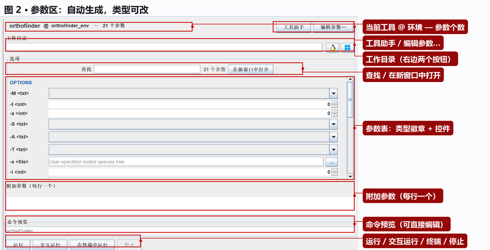
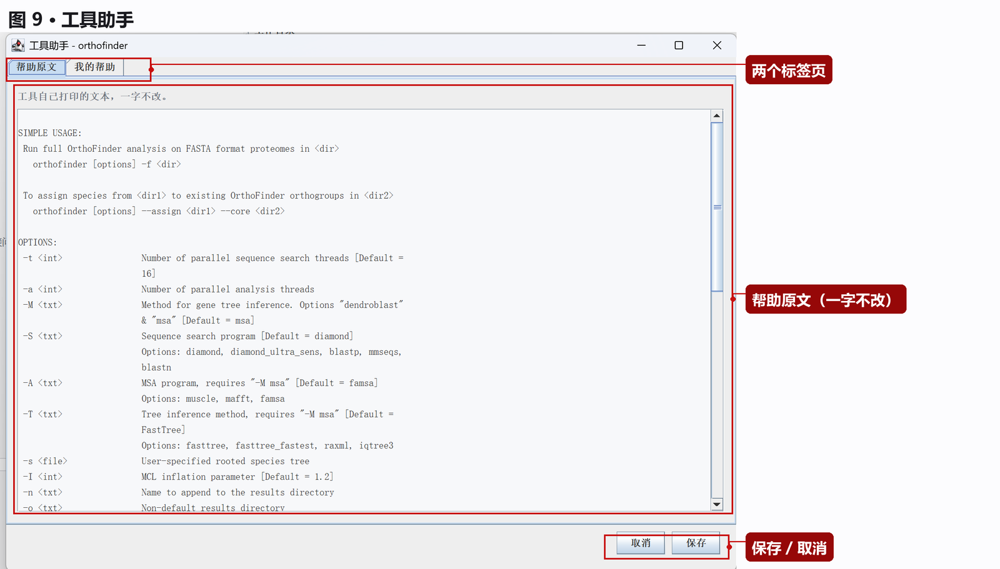
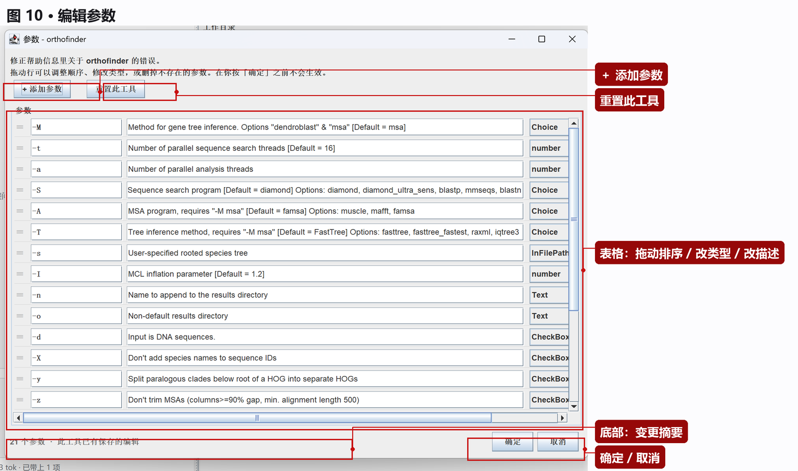
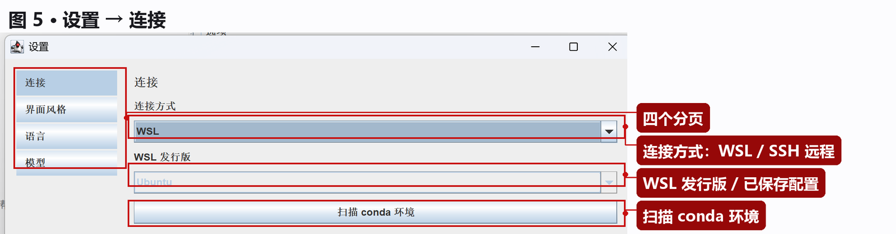
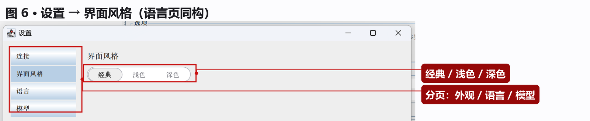
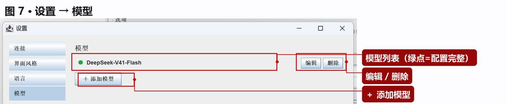
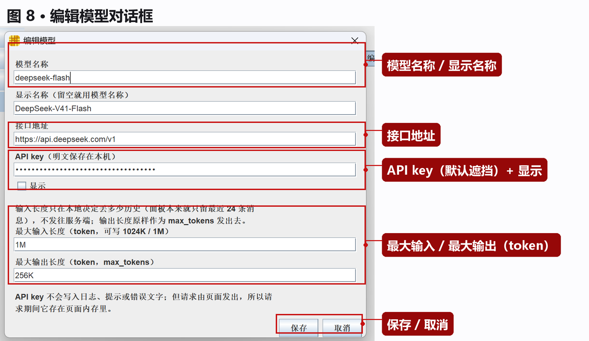
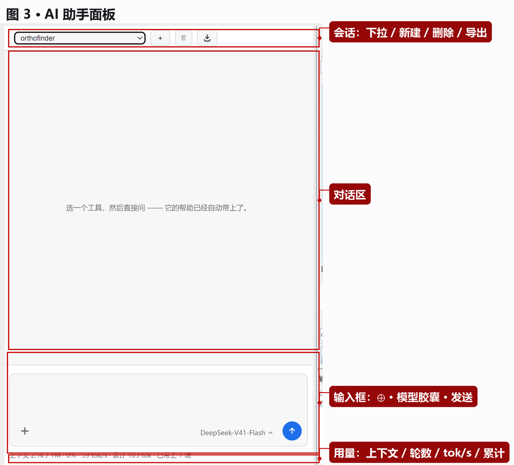
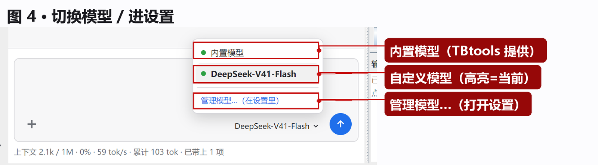

# BioEnv Caller 使用说明（图文版）

> 一个 TBtools 插件：把 **Linux 上的命令行生信工具**变成图形界面，并配一个**看得见当前工具上下文的 AI 助手**。
>
> 运行位置：**本机 WSL** 或 **SSH 远程主机**。

**全文图索引**

| 图 | 内容 |
|---|---|
| [图 1](#4-界面总览) | 主界面总览 |
| [图 2](#6-填参数参数区) | 参数区逐项说明 |
| [图 3](#11-ai-助手) | AI 助手面板 |
| [图 4](#115-换模型) | 切换模型 |
| [图 5](#101-连接) | 设置 → 连接 |
| [图 6](#102-界面风格) | 设置 → 界面风格 |
| [图 7](#104-模型) | 设置 → 模型 |
| [图 8](#104-模型) | 编辑模型对话框 |
| [图 9](#8-工具助手) | 工具助手窗口 |
| [图 10](#9-编辑参数) | 编辑参数窗口 |

---

## 0. 三分钟跑通

```
① 装插件 → ② 设置里选 WSL/SSH → ③ 点「扫描 conda 环境」
→ ④ 左边点一个工具 → ⑤ 填必填参数 → ⑥ 点「运行」
```

具体：

1. TBtools → **Install Plugin** → 选 `BioEnvCaller.plugin` → **重启 TBtools**
2. 打开 **BioEnv Caller** 标签页 → 点左侧图标栏最底下的 **⚙**
3. **连接** 页：连接方式选 `WSL`（或 `SSH 远程`）→ 点 **扫描 conda 环境**
4. 扫描完，左边出现"环境 → 工具"的树 → 点一个工具
5. 中间填参数（必填的看描述）
6. 看一眼 **命令预览** → 点 **运行**

---

## 1. 它解决什么问题

生信工具大半是 Linux 命令行程序：参数几十个、帮助是英文、路径要在 Windows 和 Linux 之间倒腾。

| 痛点 | 这个插件的做法 |
|---|---|
| 记不住参数、拼不对命令 | 选工具 → **自动生成参数表单** → 自动拼出命令；命令框还能直接改 |
| 看不懂某个参数 | **工具助手**里放工具的帮助原文；更细的问题问 **AI 助手**（它自动带着当前工具的帮助、参数表、工作目录、上次的报错） |
| Windows 上不好跑 Linux 工具 | 直接连 **WSL** 或 **SSH 远程**，在那边跑，输出回传到插件里 |

**它不是**：不是 Windows 原生工具的界面，不是流程编排（workflow）工具，也不替代命令行 —— 它就是"把这一个命令填对、跑起来、看懂输出"。

---

## 2. 能连接什么

### 2.1 WSL（本机，先用这个）

- 连 **Windows 上已安装的 WSL 发行版**（Ubuntu / Debian / …；装了多个会列出来让你选）
- 要求：Windows 10/11，WSL 装好并能正常进 shell
- WSL 和 Windows 之间有 `/mnt/c`，**Windows 路径在 WSL 里本来就能直接用**

### 2.2 SSH 远程

- 连 **任何能用 `ssh` 登录的 Linux 主机**：云服务器、实验室工作站、超算登录节点
- 需要：主机名或 IP、端口（默认 22）、用户名、**密码或密钥**
- 支持多个**已保存配置**（一个名字对一台机器），随时切换
- 连接向导里可以：逐步填主机→端口→用户→密码（每步都有校验）；**生成密钥并装到服务器的 `authorized_keys`**；连接测试会区分**拒绝连接 / 超时 / 主机解析不了**

> SSH 下没有 `/mnt/c`：选 Windows 上的文件时，插件会**把文件复制进 Linux 侧工作目录**，再把复制后的路径填进参数。

### 2.3 工具从哪来

工具**不是手工登记的**，是从 conda 环境里扫出来的：找 conda 安装位置 → 遍历环境 → 列出每个环境里能执行的命令。

- **Linux 侧 `conda install` 了什么，扫一下这里就有什么**
- 新装工具后点「扫描 conda 环境」刷新；有缓存，环境没变时很快

---

## 3. 安装与要求

| 项目 | 要求 |
|---|---|
| 宿主 | **TBtools-II** |
| 系统 | Windows 10 / 11 (x64) |
| 运行环境 | 本机 **WSL**，或可 SSH 登录的 **Linux 主机** |
| AI 助手（可选） | TBtools **2.558+**（TBmodel 桥）；网页运行时（JxBrowser）由 TBtools 按需下载 |
| 不装 AI 也能用 | 除 AI 那条之外，所有功能不依赖网络和模型 |

安装：TBtools → 插件菜单 → **Install Plugin** → 选 `BioEnvCaller.plugin` → **重启 TBtools**。
升级同理（覆盖旧的），**装完必须重启**。

---

## 4. 界面总览


| 区域 | 干什么 |
|---|---|
| **图标栏**（最左一列） | 三个图标，同时是开关：**工具树** / **AI 助手** / **⚙ 设置**（设置是独立窗口） |
| **工具树** | 左边一列，按 conda 环境分组的命令列表 + 检索框 |
| **参数区** | 右上，当前工具的参数表单、命令预览、运行按钮 |
| **输出面板** | 右下，命令打印的内容 |
| **状态栏** | 最底：左边一句提示，右边当前连接（如 `WSL · Ubuntu`） |

**图标栏的用法**：点一下展开对应的卡，再点一下收起。工具树和 AI 助手**共用同一列**，所以只有一份宽度：**分隔条可以拖**，宽度会记住；**双击分隔条**恢复默认。

---

## 5. 选工具（工具树）

- 标题：**命令（按环境分组）**
- **工具检索**：按名字过滤
- 树的结构：`环境（工具数）` → `工具`
- 每个环境/工具前有个**彩色圆点**：只是为了好认（不同环境一眼分开），**颜色没有含义**
- 点工具名 → 右边的参数区切到它

> 树里没有工具 = Linux 侧没装或没扫描。见 [常见问题](#13-常见问题)。

---

## 6. 填参数（参数区）



从上到下逐项说：

### 6.1 标题行

`orthofinder @ orthofinder_env — 21 个参数`：当前工具、它属于哪个环境、解析出多少个参数。

右侧两个按钮：**工具助手**（[图 9](#8-工具助手)）、**编辑参数…**（[图 10](#9-编辑参数)）。

### 6.2 工作目录

命令在哪个目录执行。

- 可以直接填 Linux 路径
- 右边两个按钮：**选目录**（浏览 Linux 目录树）、**在 Linux 侧新建**（新建一个工作目录并填进来）
- 需要写大量文件的工具，用 **Linux 侧目录**比 `/mnt/c/...` 快很多

### 6.3 选项行

| 控件 | 作用 |
|---|---|
| **查找** | 只显示名称/别名/说明里含这段文字的参数（参数多的工具必备） |
| `21 个参数` | 当前工具的解析结果 |
| **在新窗口中打开** | 把参数表单弹成独立窗口（表单太长/要全屏时用） |

### 6.4 参数表

每行一个参数，左边是**类型徽章**（`<txt>` `<int>` `<file>` `<Choice>` `<CheckBox>` …），右边是对应的控件：

| 类型 | 控件 | 说明 |
|---|---|---|
| 文本 `<txt>` | 输入框 | 自由文本 |
| 数字 `<int>` | 数字框 | 帮助里写了范围就按范围限制 |
| 开关 | 勾选框 | 这种参数不带值（如 `-d`） |
| 枚举 `Choice` | 下拉框 | 帮助里列了可选值（如 `-S diamond/blastp/...`） |
| 文件 / 目录 `<file>` | 输入框 + `…` | 可以浏览 **Linux 侧**目录挑 |

**类型猜错了可以改**：点左边的类型徽章就能换类型 —— 这是最常用的纠错动作。

路径类参数点 `…` 有两种来源：

- **Linux 工作目录里的文件…** —— 浏览远端目录树（带权限、大小、修改时间）
- **Windows 上的文件…** —— 挑本机文件
  - **SSH 方式**：先复制进 Linux 侧工作目录，再把新路径填进来
  - **WSL 方式**：直接填 Windows 路径也能用

### 6.5 子命令

有些工具是一级级下钻的（`工具 → 子命令`）。表单顶部会显示当前层级，也可以回到上一层。

### 6.6 附加参数（每行一个）

给"解析不出来"或"临时要加"的参数用：**一行一个，原样拼到命令后面**。比如 `--threads 16` 解析器没认出来，就在这里写一行。

### 6.7 命令预览

- 每改一个参数，命令就重拼一次
- **可以直接在框里改**（改完标题会变成"命令预览（已手工编辑）"，表单不再覆盖它）
- 点 **重置命令** 从当前表单重新拼

### 6.8 运行按钮

`运行` / `交互运行` / `在终端中运行` / `停止` —— 见下一节。

---

## 7. 运行与输出

### 7.1 四种运行方式

| 按钮 | 什么时候用 | 行为 |
|---|---|---|
| **运行** | 大多数情况 | 在插件里跑，输出实时刷到输出面板；结束显示退出码和用时 |
| **交互运行** | 程序中途要你输入 | 跑起来后，**输出面板底部**出现一行「输入：」，敲一行发一行 |
| **在终端中运行** | 长任务 / 要进度条 / 要自己中断 | 开一个真终端窗口跑；**关掉插件任务照跑** |
| **停止** | 不想等了 | 结束当前进程 |

> 几小时的任务用「在终端中运行」：在插件里跑的话，TBtools 一关连接就断了。

### 7.2 输出面板

- 右上角 **清空**
- 跑完有一行：`--- 退出码 0，用时 3.2 秒 ---`
- 工具输出里的 **ANSI 控制序列会被去掉**（否则会看到 `[0;32m` 这种乱码），所以输出是**纯文本、没有颜色**
- 失败时给一句提示：检查必需参数是否都填了、路径是否存在

---

## 8. 工具助手



两个标签页：

| 标签 | 内容 |
|---|---|
| **帮助原文** | 工具自己打印的帮助文本，**一字不改**。解析器没读懂的地方回这里看原文 |
| **我的帮助** | 你自己写的备注（这个工具怎么用、常用哪几个参数、踩过什么坑） |

**备注只供查看**：不参与解析，也不会改变参数表 —— 写什么都行。写完点 **保存**。

---

## 9. 编辑参数



给"解析器没读全 / 读错了"的工具兜底：

| 操作 | 怎么做 |
|---|---|
| **加参数** | 点 **＋ 添加参数**（帮助里没有、但工具支持的参数） |
| **排序** | 拖动行前面的 `≡` 手柄 |
| **改名字 / 改描述 / 改类型** | 点对应格子直接改 |
| **删掉不需要的** | 那行右侧操作列删掉（随时可恢复） |
| **全部还原** | **重置此工具**（回到刚扫描出来的样子） |

- 底部显示**本次改了几处**（新增 / 删除 / 改类型 / 改名字）
- **按「确定」才生效**；「取消」不保存
- 改过的内容**会记住**（重启 TBtools 仍在）

---

## 10. 设置

点图标栏最底下的 **⚙** 打开设置窗口（独立窗口，可最大化；左侧四个分页）。

### 10.1 连接



| 项 | 说明 |
|---|---|
| **连接方式** | `WSL` 或 `SSH 远程` |
| **WSL 发行版** | WSL 方式下选发行版（只有一个时是灰的） |
| **已保存配置** | SSH 方式下选机器；第一次切到 SSH 会自动建一条；也可以「＋ 新增配置」走向导 |
| **扫描 conda 环境** | 扫描工具列表（首次使用必点） |

扫描期间状态栏会显示进度；扫完显示 `就绪。389 个命令可用，来自 Ubuntu。`

### 10.2 界面风格



`经典` / `浅色` / `深色` —— 整个插件跟着变，**AI 面板也一起变**。

### 10.3 语言

`中文` / `English` —— 包括 AI 面板的按钮和提示。

### 10.4 模型



列表里每行一个模型：

- 前面一个圆点：**绿色 = 地址和模型名都填了**，灰色 = 配置不完整
- 右侧 **编辑 / 删除**
- 下面 **＋ 添加模型**



| 字段 | 说明 |
|---|---|
| **模型名称** | 接口要的 model id，如 `deepseek-chat` |
| **显示名称** | 界面上显示的名字；**留空就用模型名称** |
| **接口地址** | 如 `https://api.deepseek.com/v1`（末尾斜杠可有可无） |
| **API key** | 默认遮挡，勾「显示」可看；明文保存在本机 |
| **最大输入长度** | 单位 token，可写 `1024K`、`1M`。**只在本地决定丢多少历史，不发给服务端** |
| **最大输出长度** | 单位 token，**原样作为 `max_tokens` 发给服务端** |

> **模型列表只有这里能改**；AI 面板里只负责"选哪一个"。

---

## 11. AI 助手

点图标栏第二个图标展开。



### 11.1 它和普通聊天框的区别

每次提问，插件会**自动**把这些发给模型：

- 当前**工具名**和**环境**
- 当前**命令**（命令预览那条）
- 当前**参数表**（每个参数的标志、值、说明）
- 当前工具的**帮助原文**
- 当前**工作目录**
- **上次运行的退出码和输出尾部**（失败时自动带一段，不用复制粘贴）
- **这台机器上装了哪些工具**（只列名字）

所以不用先把上下文贴进去。**上下文只在当次请求里带一遍**，历史里存的是"你问的那句话"。

### 11.2 两种模型

| 模式 | 是什么 | 需要 |
|---|---|---|
| **TBmodel** | TBtools 自带的模型（原来叫「内置模型」） | TBtools ≥ 2.558 |
| **自定义模型** | 你的 OpenAI 兼容接口：DeepSeek / OpenAI / 本地 Ollama / vLLM 都行 | 在设置里填地址+模型名+key |

可以配**多个**自定义模型，输入框右下角切换。

### 11.3 会话

- 表头：**会话下拉** / **＋ 新建** / **删除** / **导出**
- 会话名：新建时挂**当前工具名**，问过第一句后变成**那句话的开头**（≤20 字）
- 删除会先出一行**页内确认**（不是系统弹框），点「删除」才真删
- **只保留最近 24 条消息**（约 12 轮）：更早的会被丢掉，避免请求无限变长

### 11.4 输入区

| 操作 | 效果 |
|---|---|
| `Enter` | 发送 |
| `Shift + Enter` | 换行 |
| `Esc` | 停止生成 |

| 元素 | 作用 |
|---|---|
| **⊕**（左下） | 附件：文本文件（内容拼进问题）、图片（**只有 TBmodel 支持**） |
| **模型胶囊**（右下） | 点开切换模型（[图 4](#115-换模型)） |
| **圆形按钮**（右下角） | 发送；生成中变 ■，点一下停止 |

### 11.5 换模型



点模型胶囊 → 列表里选一个（打勾的是当前），最后一行「**管理模型…**」直接打开设置。

### 11.6 回答下面那一行

`[重试] [编辑] [继续] [复制]`

| 按钮 | 干什么 |
|---|---|
| 重试 | 同一个问题再发一次（限流、超时、断网后最常用） |
| 编辑 | 把问题放回输入框，改完再发 |
| 继续 | 发"继续"，让被截断的回答接着写 |
| 复制 | 复制整条回答 |

**每个代码块右上角还有自己的复制按钮** —— 只要命令时用它。

请求失败的那一轮**会留在对话里**（红框提示），但**不进模型历史**。主题/语言变化会同步到 AI 面板。

### 11.7 底部那行数字

```
上下文 12.3k / 1M · 1% · 3 轮 · 128 tok/s · 累计 650 tok
```

| 项 | 含义 |
|---|---|
| `上下文 12.3k` | 这次请求实际发出去多少 token。**带 `≈` 是估算**（服务端没返回真实用量），不带的是服务端真实值 |
| `/ 1M · 1%` | 相对「最大输入长度」的占用 |
| `3 轮` | 本次会话回答过几次 |
| `128 tok/s` | 当前生成速度（最近 2 秒滑动窗口） |
| `累计 650 tok` | 本次会话累计输出 token |

### 11.8 导出

点表头的 **导出** 按钮 → 系统保存对话框 → 存成 `.md`：

```markdown
# 会话名

> 导出时间 2026-10-19 16:30 · 模型 DeepSeek-V4.1-Flash · 3 轮

## 我
问题…
## AI
回答…
```

UTF-8 无 BOM；只导出当前会话；失败的那轮不进导出。

### 11.9 API key 的安全边界（请读）

- key **明文**保存在本机 `%USERPROFILE%\.TBtools\BioEnvCaller\ai-models.properties`
- **不会**出现在日志、提示、错误信息里（服务端回显的 key 会打码成 `***`）
- **但**：自定义模型的请求是**网页里发出**的，所以请求期间 key 在网页内存里
- 建议：**给这个 key 单独设额度**，别用主账号的全权限 key

---

## 12. 数据存在哪

配置都在 `%USERPROFILE%\.TBtools\BioEnvCaller\`：

| 文件 | 内容 |
|---|---|
| `ai-models.properties` | 自定义模型（含 API key，明文） |
| `connection-mode.txt` | 上次用的连接方式 |
| `last-target.properties` | 上次选的环境/工具 |
| `type-corrections.properties` | 你改过的参数类型 |
| `custom-options.properties` | 你手动加的参数 |
| `tool-notes.properties` | 「我的帮助」里的备注 |
| `discovery-cache.properties` | 扫描结果缓存 |
| `language.txt` | 界面语言 |

- **AI 对话记录**存在内置网页的 localStorage 里（不在上面目录）
- **导出的 Markdown** 存在你挑的位置
- **恢复出厂**：关掉 TBtools，删掉这个目录即可（AI 对话记录另算）

---

## 13. 常见问题

### 左边树是空的 / 工具不全

1. 设置 → 连接 → **扫描 conda 环境**
2. 确认选的发行版/配置对（状态栏右边有当前连接）
3. SSH 的话：先在服务器上 `conda activate 环境`、`which 工具名` 确认工具在

### 提示「没有找到可用的 conda 安装」

WSL 里没装 conda，或 conda 不在常见路径。装 Miniconda/Anaconda，工具用 `conda install` 装，再扫描。

### 工具不在列表里

扫描按 **conda 环境**找；用系统包管理器（apt/yum）装的可能扫不到。装完新工具**必须重新扫描**。

### 命令跑不起来

1. 看输出面板的**退出码**和错误文本
2. 检查**必需参数**是否都填了
3. 检查**路径**在 Linux 侧是否存在（表单里是 Linux 路径）
4. 把命令预览里的命令**复制到终端手跑一遍** —— 能跑通是界面层问题，跑不通是命令本身不对

### SSH 连不上

| 提示 | 意思 |
|---|---|
| 拒绝连接 | 端口不对，或服务端没开 ssh |
| 超时 | 网络/防火墙没放行 |
| 主机解析不了 | 主机名写错 |

先用 `ssh 用户名@主机 -p 端口` 在 Windows 终端里试通。

### AI 面板空白 / 显示「桥不可用」

- 需要 **TBtools 2.558+**
- 网页运行时（JxBrowser）由 TBtools **按需下载**：先在 TBtools 里打开任意网页型插件，等下载完，再重开 AI 面板

### 自定义模型连不上

请求是**网页**发出的，浏览器有 **CORS** 限制：

- 本地 Ollama：设环境变量 `OLLAMA_ORIGINS=*` 后重启 Ollama
- 自建服务：允许来自 `file://` 的跨域请求

### 上下文百分比一直是 0%

「最大输入长度」填得太大（如 1M）而实际只有几 k，所以是 0 —— 正常。填小一点（如 128K）就明显了。

### 「上下文」前面的 `≈` 是什么

表示这个数字是**估算**的（服务端没返回真实用量）。不带 `≈` 的是真实值。

### 会话怎么变短了

**只保留最近 24 条消息**。重要对话请**导出成 Markdown**。

### 导出的文件在哪

你点「保存」时选的位置；成功后状态栏会显示完整路径。

---

## 14. 已知限制

| 限制 | 说明 |
|---|---|
| **只面向 Linux 工具** | Windows 原生命令工具不在范围内 |
| **一次一个工具** | 不做流程编排；串联多个工具用「在终端中运行」自己写脚本 |
| **AI 只带最近 24 条消息** | 长对话会丢早期内容；重要内容请导出 |
| **自定义模型不支持图片** | 图片附件只能配 TBmodel |
| **自定义模型受 CORS 限制** | 见上 |
| **输出无颜色** | ANSI 序列被剥掉，纯文本 |
| **还没做** | 对话搜索、命令语法高亮 |

---

## 附：一句话速查

```
装：TBtools → Install Plugin → 选 .plugin → 重启
连：⚙ → 连接 → WSL / SSH → 扫描 conda 环境
用：左树选工具 → 填表单 → 看命令预览 → 运行
看不懂：工具助手（帮助原文）或 AI 助手（直接问）
跑不对劲：命令预览复制到终端手跑一遍
```
